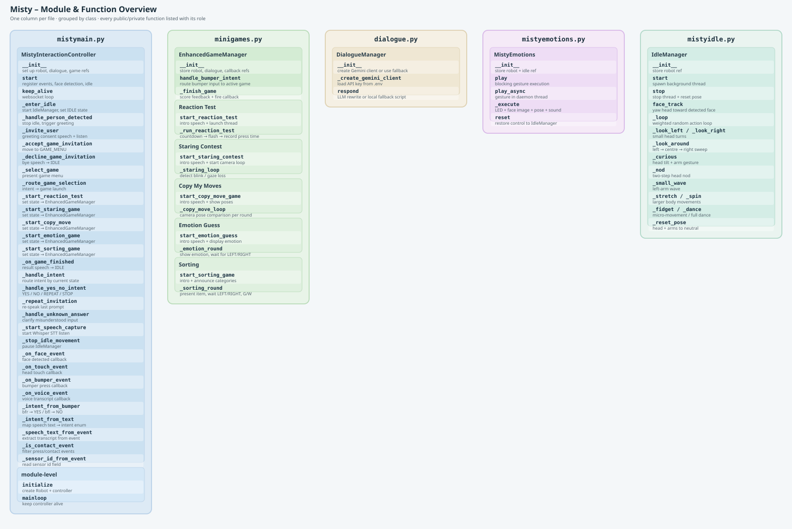

# Misty Human-Robot Interaction Prototype

This project contains the interaction script for a Misty robot prototype designed for a playful university open day scenario. Misty acts as an interactive game host: she waits for people, invites them into a short interaction, dynamically guesses if they are future engineers, and guides them through various interactive mini-games and conversational moments.

## Current Concept

The implementation features a complete multi-game interaction architecture:

- **Greeting & Consent**: Misty starts in an `IDLE` state with alive-movements. When a person is detected or her head is touched, she asks for consent to look at them. If granted, she dynamically guesses if they are a future engineer and logs the result to improve her performance.
- **Game Selection Menu**: Misty presents 5 distinct mini-games. Users can say the name of a game directly, or press the **LEFT** button to cycle through spoken descriptions. If a user gets distracted or remains silent, Misty takes the initiative and picks a game for them.
- **Integrated Mini-Games**:
  - *Staring Contest*: Uses the camera to track eye contact and detect blinks. Features real-time teasing lines and cheat detection.
  - *Copy My Moves Game*: Misty performs a physical pose (arms/head) and evaluates the user's mirroring accuracy via the camera.
  - *Reaction Speed Test*: Misty flashes her eyes randomly; the user must press the **LEFT** button as fast as possible (with early-press penalties).
  - *Emotion Guessing Game*: A 3-round challenge where Misty uses eyes, sounds, and posture to express an emotion, and the user guesses it.
  - *Sorting Challenge*: A fast-paced categorization game where items must be sorted to the **LEFT** or **RIGHT** category side.
- **Input Normalization & Fallbacks**: Text speech and physical touch/bumper buttons are normalized into shared conversation intents. Bumpers and explicit button mappings remain the reliable fallback for noisy open day conditions.
- **Global Conversational Triggers**: Active during all dialogs to handle generic human questions like *"Who are you?"*, *"Can you repeat that?"*, or *"Start over"*.
- **Hybrid Dialogue Architecture**: The core game state logic is rule-based, while a **Gemini LLM client** (`gemini-2.0-flash-lite`) dynamically rewrites lines and injects emotional tones. If offline or no API key is present, the script seamlessly switches to hardcoded local script fallbacks.

---

## Project Structure

```
Misty/
├── mistymain.py              # Entry point & MistyInteractionController
├── minigames.py              # EnhancedGameManager + all 5 mini-game state machines
├── dialogue.py               # DialogueManager: Gemini client + local fallback scripts
├── mistyemotions.py          # MistyEmotions: LED, display & pose helpers
├── mistyidle.py              # IdleManager: alive-movement loop (with movement)
├── mistyidle_NoMovement.py   # IdleManager variant without physical movement
├── generate_readme_figure.py # Script to regenerate docs/red_thread_flow.svg
├── requirements.txt
├── .env                      # GEMINI_API_KEY + GEMINI_MODEL (not committed)
├── docs/
│   ├── red_thread_flow.svg   # Auto-generated architecture diagram (see below)
│   └── Dialog.docx           # Full scripted dialogue document
└── TestingCheck.txt          # Manual test checklist & button-flow reference
```

## Module Overview

| File | Responsibility |
|---|---|
| `mistymain.py` | Robot connection, event registration, STT (Whisper), state machine, input normalization |
| `minigames.py` | All 5 mini-game loops with threaded timers and per-game state enums |
| `dialogue.py` | `DialogueManager` wraps Gemini API; falls back to local script arrays when offline |
| `mistyemotions.py` | Reusable helpers: set LED color, display emotion image, perform arm/head poses |
| `mistyidle.py` | Background thread that animates Misty with slow head and arm movements while idle |
| `mistyidle_NoMovement.py` | Same idle loop but with all movement calls disabled (e.g. for demo stands with limited space) |

## Architecture Diagram

`docs/red_thread_flow.svg` gives a full visual overview of all modules, classes, and functions. One column per file, grouped by class, with every function and its role listed inline. Regenerate it at any time by running:

```bash
python generate_readme_figure.py
```



---

## Setup

### Hardware Requirements

- **Misty II robot** — reachable over WiFi at the IP configured in `MISTY_IP` (`192.168.0.151` by default)
- **Laptop** with a working microphone (used for STT via `faster-whisper`)
- **CUDA GPU** (optional) — the STT loader automatically falls back to CPU (`int8`) if no GPU is found
- Python 3.10+

### Install dependencies

```bash
pip install -r requirements.txt
```

> **Note:** `torch` is pulled from the PyTorch CUDA 12.8 index. If you don't have a CUDA GPU, replace that line in `requirements.txt` with the standard `torch` package.

### Environment variables

Set up your environment variables in a `.env` file:

```
GEMINI_API_KEY=your_api_key_here
GEMINI_MODEL=gemini-2.0-flash-lite
```

---

## Configuration

| Variable | Location | Description |
|---|---|---|
| `MISTY_IP` | `mistymain.py` | IP address of the Misty robot on your LAN |
| `VOLUME` | `mistymain.py` | Misty's speaker volume (0–100) |
| `LISTENING_SYSTEM_ENABLED` | `mistymain.py` & `minigames.py` | `True` = voice input active; `False` = button-only mode |
| `GEMINI_API_KEY` | `.env` | Google Gemini API key |
| `GEMINI_MODEL` | `.env` | Model string, e.g. `gemini-2.0-flash-lite` |

---

## Game Flow Reference (Button Mapping)

All games share the same physical input mapping:

| Button | In-game meaning |
|---|---|
| **LEFT bumper** | Yes / Ready / Cycle options / Rematch |
| **RIGHT bumper** | No / Skip / Return to Game Menu |

### Interaction Entrypoints → Game Menu

```
Head touch / Face detected / Bumper press
  └─ Greeting consent
        ├─ NO  → Back to IDLE
        └─ YES → Engineer scan (Gemini guess)
                      └─ Game Menu
                           ├─ NO (right) → IDLE
                           ├─ LEFT       → Random game selected
                           └─ Speech     → Named game selected
```

### Reaction Test

```
Intro speech
  ├─ RIGHT → Game Menu
  └─ LEFT  → "Get ready" countdown
                └─ Flash → User presses LEFT/RIGHT as fast as possible
                              └─ Score feedback
                                    ├─ RIGHT → Game Menu
                                    └─ LEFT  → Rematch
```

### Staring Contest

```
Intro speech
  └─ LEFT → Staring begins
               ├─ Human looks away  → Misty wins  → End
               ├─ Misty blinks first → Misty loses → End
               ├─ RIGHT → Forfeit → End
               └─ LEFT  → Forfeit → End
  End
    ├─ RIGHT → Bye speech → Game Menu
    └─ LEFT  → Rematch
```

### Copy My Moves

```
Intro speech
  ├─ RIGHT → Game Menu
  └─ LEFT  → Pose 1 shown
                └─ LEFT/RIGHT → (happy/sad line) → Pose 2
                                   └─ LEFT/RIGHT → Pose 3
                                                     └─ LEFT/RIGHT → Score (0–3 correct)
  Score feedback → End
    ├─ RIGHT → Game Menu
    └─ LEFT  → Rematch
```

### Emotion Guessing Game

```
Intro speech
  ├─ RIGHT → Game Menu
  └─ LEFT  → Emotion 1 displayed
                └─ LEFT/RIGHT (guess) → Correct/Wrong feedback → Emotion 2
                                           └─ LEFT/RIGHT → Emotion 3
                                                             └─ LEFT/RIGHT → Final score (0–3)
  Score feedback → End
    ├─ RIGHT → Game Menu
    └─ LEFT  → Rematch
```

### Sorting Challenge

```
Intro speech (difficulty adapts to previous score)
  ├─ RIGHT → Bye speech → Game Menu
  └─ LEFT  → Categories announced → Item 1
                └─ RIGHT/LEFT (sort) → Correct/Wrong → Item 2 → … → Item 5
                                                                        └─ Final score (0–5)
  Score feedback → End
    ├─ RIGHT → Game Menu
    └─ LEFT  → Rematch
```

---

## Red Thread Through The Code

The script starts at the bottom of `mistymain.py`. The main entry point creates the robot connection, creates the controller, starts the interaction system, and then keeps the event subscriptions alive.

```
if __name__ == "__main__"
|
+-- initialize()
|   |
|   +-- Robot(MISTY_IP)
|   +-- MistyInteractionController(misty)
|   +-- controller.start()
|
+-- mainloop(app)
    |
    +-- controller.keep_alive()
```

The controller startup prepares the robot, registers all sensor/speech events, starts face detection, and enters the default idle state.

```
MistyInteractionController.start()
|
+-- SetDefaultVolume(...)
+-- _register_events()
|   |
|   +-- face_detection      -> _on_face_event(...)
|   +-- head_touch_start    -> _on_touch_event(...)
|   +-- bumper_input        -> _on_bumper_event(...)
|   +-- voice_input         -> _on_voice_event(...)
|
+-- _start_face_detection()
+-- _enter_idle()
```

The interaction flow is completely state-driven. Misty shifts through greeting consent, engineer validation, a multi-option game choosing menu, and routes execution to the specified game loop.

```
IDLE
|
+-- face detected or head touched
    |
    +-- _handle_person_detected(...)
        |
        +-- _stop_idle_movement()
        +-- _invite_user() (GREETING_CONSENT)
            |
            +-- YES -> _handle_engineer_guess() (ENGINEER_CONFIRM)
            |          |
            |          +-- YES/NO -> _select_game() (GAME_MENU)
            |
            +-- NO  -> _decline_game_invitation() -> IDLE

GAME_MENU
|
+-- speech input or LEFT button
    |
    +-- _route_game_selection(...)
        |
        +-- "staring contest"  -> _start_staring_game()   -> STARING
        +-- "copy my moves"    -> _start_copy_move()      -> COPY_MOVE
        +-- "reaction speed"   -> _start_reaction_test()  -> REACTION
        +-- "emotion guessing" -> _start_emotion_game()   -> EMOTION_GUESS
        +-- "sorting challenge"-> _start_sorting_game()   -> SORTING
        +-- TIMEOUT (5s / 10s) -> Auto-takes initiative  -> REACTION
```

Input is normalized before it affects the conversation. This means different physical input sources and verbal expressions share the exact same dialogue logic.

```
Bumper & Button Input
|
+-- _on_bumper_event(...) / _on_button_event(...)
    |
    +-- _intent_from_bumper(...)
        |
        +-- front right / RIGHT button -> YES / MOVE ON
        +-- front left / LEFT button   -> NO / GAME OPTIONS / DESCRIPTION

Speech input
|
+-- _on_voice_event(...)
    |
    +-- _speech_text_from_event(...)
    +-- _intent_from_text(...)
        |
        +-- "yes", "yeah", "sure", "pretty close" -> YES
        +-- "no", "nope", "wrong", "not now"     -> NO
        +-- "stop", "give up", "quit"            -> STOP
        +-- "who are you"                        -> ASK_WHO
        +-- "repeat that", "repeat"              -> ASK_REPEAT
        +-- "don't understand"                   -> ASK_NOT_UNDERSTAND
        +-- "start over"                         -> ASK_START_OVER
```

Dialogue generation uses a highly adaptive hybrid structure. The state machine enforces system execution guidelines while the dialogue manager uses Gemini to generate organic spoken feedback and context-aware robot expressions.

```
Controller requests a spoken script response
|
+-- DialogueManager.respond(state, user_input, context)
    |
    +-- Gemini Client active + API key valid -> Generate dynamic JSON response
    |                                           (Injects context, text & emotional tone)
    |
    +-- Otherwise (OFFLINE fallback mode)   -> Fetch randomized scenario response 
                                                from local script mapping array
```